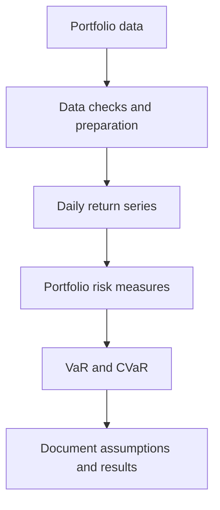
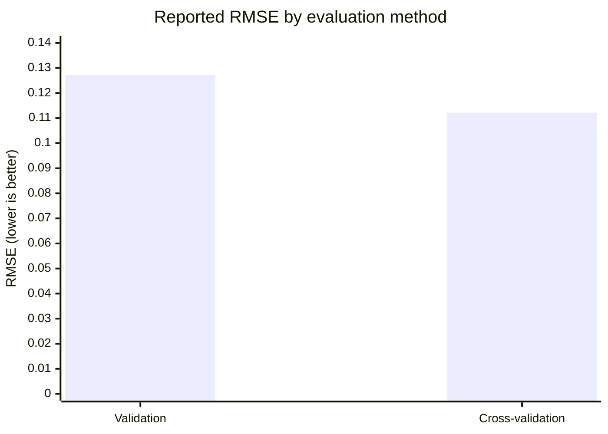
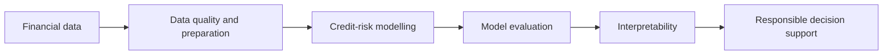
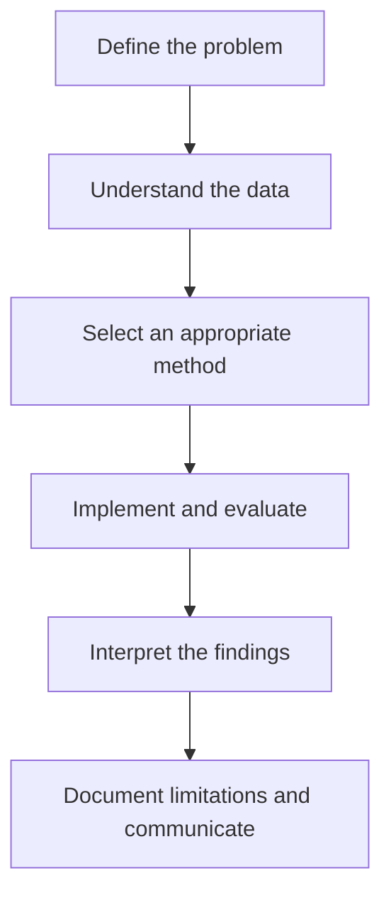

# Oluwasomidotun Odumosu
### Computational Modelling · Quantitative Finance · Data Analytics · Machine Learning

**Connecting financial experience with computational thinking.**

I am a banking and credit operations professional pursuing an MSc in **Computational Modeling in Technology and Finance at Southern Federal University, Rostov-on-Don, Russia**. I combine practical financial experience with a growing focus on quantitative methods, data analytics, machine learning and computational modelling.

My interest is in understanding real problems, analysing the data behind them, and building transparent, reproducible approaches that can support better decisions.

[**Portfolio Website**](https://dotunodumosu.github.io/) · [**LinkedIn**](https://www.linkedin.com/in/oluwasomidotun-odumosu-31854b177/) · [**Email Me**](mailto:odumosu@sfedu.ru)

---

## At a Glance

| Area | Focus |
|---|---|
| Academic direction | Computational modelling and quantitative finance |
| Professional foundation | Banking and credit operations |
| Technical focus | Python, data analysis, model evaluation and portfolio risk |
| Research interest | Explainable machine learning for financial risk |
| Entrepreneurship | Founder, Digispix Systems Limited |

## Technical Toolkit

### Programming and data analysis

### Development and collaboration

### Methods I have been practising

- Regression and polynomial model fitting
- Validation, cross-validation and RMSE-based model comparison
- Data preparation and numerical analysis
- Portfolio return processing and VaR/CVaR implementation in collaborative research
- Reproducible notebooks and technical documentation

*These badges identify tools used in my workflow; they are not certifications or claims of expert-level proficiency.*

---

## Featured Projects

### 01 · Aegis Wealth Terminal

**Quantitative finance · Portfolio risk · Collaborative engineering**

**Status:** In progress — team project

My contribution has included work on portfolio-level daily return processing and the implementation of Value at Risk (VaR) and Conditional Value at Risk (CVaR).

#### Analytical workflow

**Tools and methods:** Python, NumPy, portfolio return analysis, VaR/CVaR and reproducible technical documentation.

- [Explore the project repository](https://github.com/31MaeStro13/aegis_rust_front)
- [Review the Phase 1 pull request](https://github.com/31MaeStro13/aegis_rust_front/pull/1)
- [Read my project case study](https://dotunodumosu.github.io/projects/aegis-wealth-terminal.html)

*The diagram illustrates the analytical workflow; it is not a screenshot of the complete application.*

---

### 02 · Machine Learning Model Selection

**Academic coursework · Regression · Model evaluation**

This experiment explores how polynomial model complexity affects predictive performance and how validation and cross-validation can lead to different model selections.

| Evaluation | Selected degree | Reported RMSE |
|---|---:|---:|
| Validation | 4 | 0.127249 |
| Cross-validation | 9 | 0.112186 |

#### Comparing the reported RMSE values

**Tools and methods:** Python, NumPy, polynomial regression, validation, cross-validation and RMSE.

The comparison highlights why model evaluation requires careful interpretation. These values come from different evaluation procedures, so they should not be treated as a direct, like-for-like test of generalisation performance.

[Explore the project notes](https://dotunodumosu.github.io/projects.html#model-selection)

---

### 03 · Explainable SME Credit-Risk Modelling

**Proposed research direction · Financial machine learning**

I am interested in investigating how quantitative modelling and interpretable machine learning could support SME credit-risk assessment in emerging African economies.

#### Proposed research workflow

Potential research questions include:

- Can financial and operational indicators help identify patterns associated with loan default?
- How can model predictions be explained to financial analysts and decision-makers?
- How should data limitations and model uncertainty be communicated?

**Potential methods:** statistical analysis, predictive modelling, model evaluation and explainability techniques.

**Status:** Research concept under development; this is not a completed empirical study.

[Explore the research concept](https://dotunodumosu.github.io/projects.html#credit-risk)

---

## How I Approach Analytical Work

I value analytical work that makes its assumptions explicit, uses appropriate evaluation methods and communicates both findings and limitations clearly.

## Research Interests

- Quantitative finance and portfolio risk
- Credit-risk modelling and SME lending
- Explainable and responsible financial AI
- Computational modelling and applied mathematics
- Data-driven decision support

## Beyond the Code

I founded **Digispix Systems Limited** with an interest in practical technology and business improvement. My entrepreneurial experience complements my academic development by keeping me focused on how analytical and technical work can address real organisational needs.

My long-term goal is to progress towards doctoral research and an academic career, contributing to work that connects mathematical rigour with meaningful financial and economic problems.

## Let's Connect

If you are a recruiter, employer, researcher or potential collaborator working in quantitative finance, data analytics, financial technology or computational modelling, I welcome relevant conversations.

- **Portfolio:** https://dotunodumosu.github.io/
- **LinkedIn:** https://www.linkedin.com/in/oluwasomidotun-odumosu-31854b177/
- **GitHub:** https://github.com/dotunodumosu
- **Email:** odumosu@sfedu.ru

---
